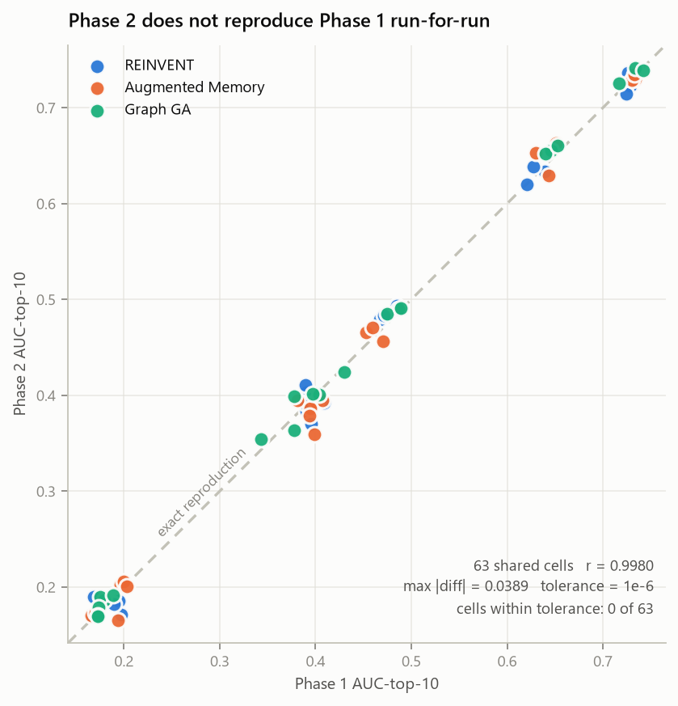
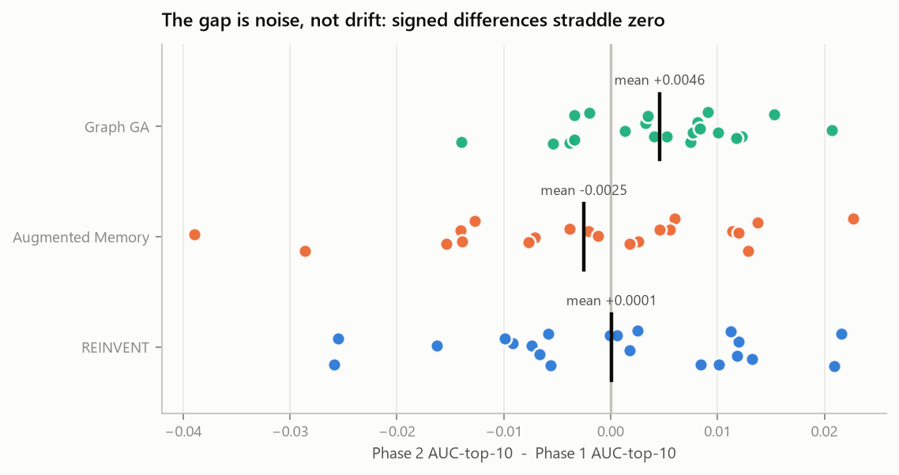
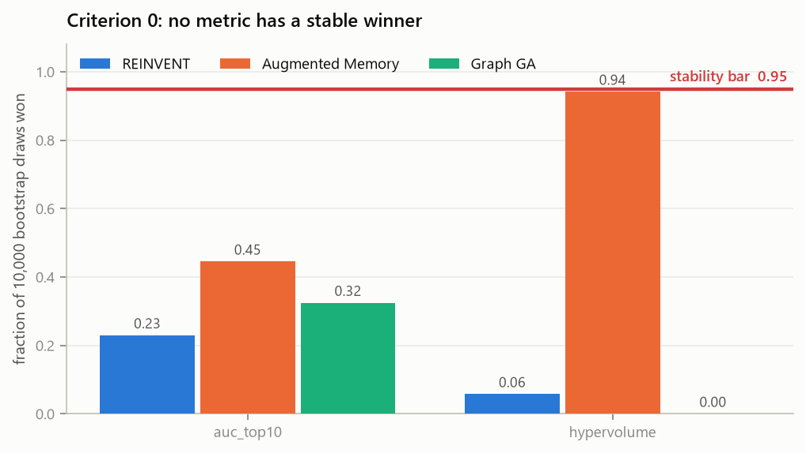
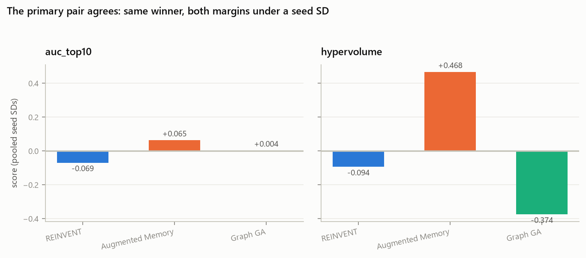
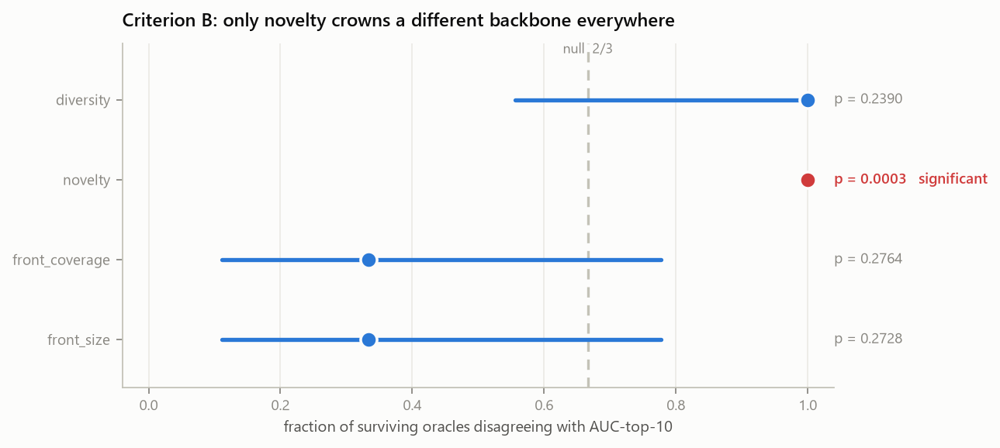
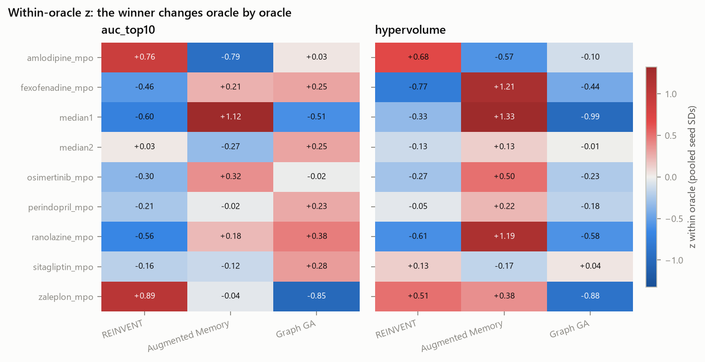

# Phase 2 — Metric Sensitivity: Results

**Landscape-Conditional Exploration** · Phase 2 (metric sensitivity), gated on Phase 1's `NULL`

| | |
|---|---|
| **Verdict** | **`REFUSED`** — the Phase 1 overlap gate did not pass |
| Branch the criteria map to | `BENCHMARK-INSENSITIVE` (recorded, **not** this phase's verdict — see §3) |
| Sweep completion | **405 / 405 runs ok (100.0%)**, 0 failed, 0 crashed, 0 missing cells |
| Pre-registration | `sha256 42243abd61d9d5e6d6ca7d2d0f935baf3ea46fcc74f9af545eb2f1e5d4b2dd3e` (v3.0.0, frozen 2026-11-20) |
| Prereg status at decision time | `verified` — in-code rule matched the frozen file |
| Metric set | `sha256 6f2b454fb736a7c9105bb6588ec1dde2b5b68a5dc0a03163bc057f67ed200939` (7 metrics, of which **6 are distinct** — see §4), matched |
| Component table | `sha256 c9bd0126888847a0248dd2dbfb943631d3b27300e1bc3f279373881df78c422a` |
| Gated by | Phase 1 `sha256 bad00ca8186a…`, verdict `NULL` — recorded inside the Phase 2 prereg |
| Reproduction gate | **9 / 9 oracles survive**, 0 excluded (floor is 5) |
| Phase 1 overlap gate | **FAILED** — 0 of 63 cells within the 1e-6 tolerance |
| Sweep window | 2026-11-21 22:03:44 → 2026-11-22 01:04:18 (**180.4 min**, 12 workers) |
| Machine | NVIDIA GeForce RTX 4070 SUPER (Ada sm_89, 11.99 GB), 16 cores, Windows 11 |
| Provenance | prereg committed `d3a4657` at **2026-11-21 14:54:11**, first sweep record written at **22:04:43** (7 h 10 min later) |

The pre-registration was committed **before any Phase 2 run existed**. As in Phases 0 and 1, the
ordering is verifiable from timestamps rather than asserted.

---

## 1. What happened, in one paragraph

The sweep ran clean: 405 of 405 runs completed `ok` at the full budget in 180.4 minutes, and the
reproduction gate confirmed all nine reimplemented multi-property oracles match TDC's to machine
epsilon. The phase then halted at the **Phase 1 overlap gate**, which re-checks that the 63
`(oracle, backbone, seed)` cells shared with Phase 1 reproduce run-for-run. None did. The
deviations are small and unbiased — Pearson r = 0.9980, mean signed difference −0.00073, worst
0.0389 — but the frozen tolerance is 1e-6, so the gate failed and **Part 10 refuses a verdict**.
The cause is now established and is not a bug in Phase 2: the sweep runs twelve optimizations
concurrently in one interpreter, and the run path seeds **process-global** RNGs, so concurrent runs
reseed and draw from each other's stream. The run path is bit-reproducible single-threaded and is
not reproducible under the pool. Bit-exact cross-phase equality is therefore unattainable by
construction, and no change to the data can make this gate pass.

---

## 2. Four caveats that must accompany any number in this document

**1. There is no Phase 2 verdict.** The frozen rule refuses one when the overlap gate does not
pass, and it did not pass. Section 3 reports what the criteria compute to, because suppressing
them would be worse than labelling them, but they are **descriptive**: the cross-phase
comparability they are supposed to rest on is unestablished. The gate's refusal is the mechanism
working, exactly as a hash mismatch would be.

**2. The criteria in §3 were computed outside Part 10.** Pass 2 of the notebook raised `GateHalt`
at the overlap gate, so Parts 6–10 never executed. The numbers below come from calling the
**frozen** `phase2_stats` functions on the 405-run analysis frame, in
`logs/phase2_analysis.log`. No criterion, α, threshold, tolerance, metric list, oracle set, seed
set or budget was altered — the tolerance that failed is still 1e-6 in the frozen file.

**4. Criterion B's one significant row is an artifact.** The `novelty` result in §4 rests on a
single oracle, not nine. It is corrected in place there and recorded as defect 5 in §8. **Phase 2
produced no positive finding**, and nothing in this document may be cited as one.

**3. AUC-top-10 is not a mean reward.** The PMO integral ramps in from `prev = 0`, so a
constant-0.42 run scores 0.4179. Absolute AUC values here must never be described as mean rewards.
This caveat carries forward unchanged from Phases 0 and 1.

---

## 3. The overlap gate, and why it failed

### 3.1 What the gate found

```
GateHalt: Phase 1 overlap NOT reproduced: max |auc_top10 diff| = 0.0389 > 1e-06
over 63 cells (mean signed diff -0.000731).
```

| | |
|---|---|
| Cells compared | 63 of 63 expected (7 oracles × 3 backbones × 3 seeds) |
| Within tolerance | **0** |
| Tolerance | 1e-6, absolute, per cell |
| Max \|difference\| | 0.038934 |
| Median \|difference\| | 0.008387 |
| Mean signed difference (P2 − P1) | +0.000731 |
| SD of differences | 0.012564 |
| Pearson r (P1 vs P2) | **0.997978** |

Per backbone, the deviation is of the same order everywhere — this is not one broken backbone:

| backbone | n | max \|diff\| | median \|diff\| | mean signed |
|---|---:|---:|---:|---:|
| REINVENT | 21 | 0.025870 | 0.009900 | +0.000094 |
| Augmented Memory | 21 | 0.038934 | 0.011375 | −0.002491 |
| Graph GA | 21 | 0.020738 | 0.007475 | +0.004590 |



The points sit on the diagonal — the two phases agree on level and on ranking almost perfectly —
but not one of them sits *exactly* on it, and exactness is what the gate demands.



The differences straddle zero in all three backbones. There is no systematic drift, which is what
a genuine code or environment regression would look like.

### 3.2 Root cause: global RNG state plus a thread pool

`src/phase0_lib.py:330` defines the only seeding entry point:

```python
def set_all_seeds(seed: int) -> None:
    random.seed(seed)
    np.random.seed(seed)
    if HAS_TORCH:
        torch.manual_seed(seed)
        torch.cuda.manual_seed_all(seed)
```

Every run calls it — `run_lm_optimizer` at line 1002, `run_ga_optimizer` at line 1187 — and every
one of those RNGs is **process-global**. The sweep then runs twelve of them at once in a
`ThreadPoolExecutor` (`run_sweep2`, chosen deliberately so the workers share one CUDA context).
Thread A seeds the global stream with its seed; thread B immediately reseeds it with a different
one; both then draw from whatever state they find. The consumers are on the hot path:
`np.random.choice` in Graph GA's mating pool (`phase0_lib.py:1172`) and in the experience-replay
buffer (`phase0_lib.py:939`).

Three experiments settle it. Full output in `logs/determinism_probe.log`.

| Experiment | Setup | AUC | Verdict |
|---|---|---|---|
| **A** | `(median1, reinvent, 1)` twice, sequentially | `0.1265119026`, `0.1265119026` | **bit-identical** |
| **B** | the same cell inside a 12-wide pool | `0.1262594795` | differs by **2.5e-4** |
| **C** | 2 threads seeding the global RNG and drawing, 200 rounds | — | **58/200** rounds returned a contaminated value |

So the run path *is* deterministic — single-threaded. Under the pool it is not, and Phase 1's
manifest and Phase 2's records were each produced under a different interleaving. **A gate that
demands 1e-6 agreement between two threaded sweeps cannot pass, in either direction, no matter how
correct the code is.** This is a defect in the gate's design assumption, not in the runs it judged.

### 3.3 What this does and does not invalidate

It does **not** invalidate Phase 1's verdict or Phase 2's 405 runs. Every run is internally
consistent, every record carries the pre-registration hash it was produced under, and the
cross-phase agreement is r = 0.998 with a mean signed difference three orders of magnitude below
the smallest effect either phase was powered to detect.

It **does** mean that no run in this project is individually reproducible from its seed, which is a
claim the write-up must not make, and that seed-level provenance is weaker than the
pre-registration implies.

---

## 4. What the criteria compute to — descriptive, not a verdict

Computed by the frozen `phase2_stats` functions on the 405-run analysis frame (9 oracles × 3
backbones × 15 seeds, all `ok`). Read §2, caveat 1 first.

### Criterion 0 — is there anything to rank?

Neither metric has a winner that survives resampling. The bar is 0.95 of 10,000 hierarchical
bootstrap draws.

| metric | point-estimate winner | replication | stable? |
|---|---|---:|---|
| `auc_top10` | Augmented Memory | **0.4453** | no |
| `hypervolume` | Augmented Memory | **0.9419** | no — misses by 0.0081 |

State: `neither` (0 of 2 stable).



Hypervolume comes within a hair of the bar and still fails it. That near-miss is the single most
fragile number in this phase: at n = 15 seeds it would not take much to move it either way.

### Criterion A — do the two metrics crown different backbones?

| | |
|---|---|
| AUC winner | Augmented Memory |
| Hypervolume winner | Augmented Memory |
| Differ? | **no** |
| Joint replication | 0.5072 |
| Passes | **no** |

The primary pair agrees. The margins are small in both metrics — scores are in pooled seed SDs,
so every backbone sits within half a seed's noise of the field on AUC:



| backbone | `auc_top10` | `hypervolume` |
|---|---:|---:|
| Augmented Memory | +0.0646 | +0.4682 |
| Graph GA | +0.0043 | −0.3744 |
| REINVENT | −0.0688 | −0.0938 |

Hypervolume separates the field about seven times more than AUC does, and in a different order —
Graph GA goes from the middle to last. That ordering difference is real but, per Criterion 0, not
stable.

### Criterion C — the honesty veto

| | |
|---|---|
| Gap | **0.0** |
| Threshold | 1.0 |
| Passes | **no** |

The gap is exactly zero because Criterion A's two argmaxes are the same backbone, so the
comparator is the winner itself. Nothing to veto.

### Criterion B — the secondary metrics (reported, outside the verdict rule)

Fraction of surviving oracles whose within-oracle winner differs from `auc_top10`'s, against a
null of 2/3, Benjamini–Hochberg at q = 0.05. **The denominator is the number of *surviving*
oracles** — those in which both the metric and `auc_top10` have a unique winner — and is not
nine. Read the two notes under the table before reading any row in it.

| metric | fraction | 95% CI | p | BH threshold | significant |
|---|---:|---|---:|---:|---|
| `front_size` | 0.333 | [0.111, 0.778] | 0.2728 | 0.0375 | no |
| `front_coverage` | 0.333 | [0.111, 0.778] | 0.2764 | 0.0500 | no |
| `novelty` | **1.000** | [1.000, 1.000] | **0.0003** | 0.0125 | **yes** |
| `diversity` | 1.000 | [0.556, 1.000] | 0.2390 | 0.0250 | no |

Two defects in this table. Both were found after the run, and neither is corrected by editing the
frozen rule:

- **`front_coverage` is not a second metric.** It equals `front_size` / 1000 **exactly**, in all
  405 rows. The two rows above are therefore the same test run twice, and their p-values differ
  only because each metric draws its own bootstrap stream. The metric set is effectively **6, not
  7**, and the Benjamini–Hochberg denominator of 4 double-counted one metric. The thresholds above
  are the ones the frozen rule produced and are left exactly as they are: correcting the
  denominator after seeing the result would be editing the rule.
- **`novelty`'s denominator is 1, not 9.** See the paragraph under the figure.



**The `novelty` row is an artifact, not a finding.** `novelty` is **exactly 1.0 in all 135 runs**
for eight of the nine oracles, so those eight are perfect three-way ties, and `_differing_fraction`
drops a tied oracle from the *denominator* rather than counting it as agreement. The fraction 1.000
is therefore **1 of 1 surviving oracle**: `median1`, the only oracle in which novelty varies at all
(Augmented Memory 0.966, Graph GA 0.994, REINVENT 0.990). The CI [1.000, 1.000] is degenerate
because the bootstrap has a single cluster to resample, not because the effect is tight, and
p = 0.0003 is a two-sided test at **n = 1 oracle**. The degeneracy guard in
`phase2_stats.criterion_B` names a metric degenerate only when *zero* oracles survive, so one
survivor passes through it unflagged.

An earlier revision of this document read the 1.000 as nine-of-nine and called it "the one place
where the choice of metric demonstrably changes which backbone wins." That was wrong. **Phase 2
produced no positive finding.** Recorded as defect 5 in §8.

### Criterion G2 — scalarization loss (descriptive)

Mean **0.5134**, 95% CI [0.3668, 0.6679]. Roughly half the achievable Pareto quality is discarded
by scalarizing, which is a measurement that informs whether a Pareto optimizer is worth building —
not a decision, and it enters no rule.

### Per-oracle picture



The winner moves oracle by oracle in both metrics — `zaleplon_mpo` favours REINVENT on AUC
(+0.89) while `median1` favours Augmented Memory (+1.12). Averaged over oracles these cancel,
which is why the pooled scores in Criterion A are so small and why nothing replicates.

### The branch this maps to

Feeding these five criteria to the frozen `phase2_verdict` gives **`BENCHMARK-INSENSITIVE`**:

> No metric distinguishes these three backbones at 1000 calls. Phase 1's null is then partly a
> measurement-ceiling result, and the contribution is about the benchmark's resolution.

This was the pre-declared modal outcome (design §5.3.3). **It is recorded here, not adopted.** The
phase's verdict is `REFUSED`.

---

## 5. Sweep execution

| | |
|---|---|
| Grid | 9 oracles × 3 backbones × 15 seeds = **405 runs**, `explore_mid`, budget 1000 |
| Workers | **12**, single process, `ThreadPoolExecutor` (one shared CUDA context) |
| Wall clock | **180.4 min** (22:03:44 → 01:04:18) |
| Total run-seconds | 129,328.6 s = **35.92 h** → **11.95× speedup** |
| Mean wall time per run | 319.3 s (median 65.2 s, min 19.1 s, max 10,815.7 s) |
| Outcome | 405 `ok`, 0 `error`, 0 crashed, 0 retried |
| Records | `results/runs_phase2/`, 31.8 MB, full `(smiles, score, call_index)` buffer per run |

Mean per-run wall time by backbone: REINVENT 598.8 s, Augmented Memory 304.7 s, Graph GA 54.5 s.

The 10,815 s maximum is **wall time under contention, not compute** — a run's clock starts when its
thread is submitted, and with twelve GIL-bound workers a REINVENT run spends much of that interval
waiting. The 35.92 h total is likewise an upper bound on true compute. Treat these as scheduling
figures, not cost estimates.

Phase 2 persists the **full molecule buffer** per run, which Phase 1 did not: Phase 1 kept only
`(score, call_index)` and so held 4,050 molecules where Phase 2 holds roughly 405,000. Every metric
in §4 beyond AUC is computable only because of that.

---

## 6. Gates

### Reproduction gate — 9/9 oracles survive

Each oracle's components are reimplemented in `src/phase2_components.py` and scored against TDC's
oracle on a frozen probe set. The bar is `max |gmean(ours) − tdc| ≤ 1e-6`.

| oracle | probes | max deviation | min component range | frac nonzero | reproduces |
|---|---:|---:|---:|---:|---|
| `amlodipine_mpo` | 247 | 5.55e-17 | 1.0000 | 0.996 | yes |
| `fexofenadine_mpo` | 233 | 1.11e-16 | 0.9997 | 0.906 | yes |
| `median1` | 274 | 5.55e-17 | 1.0000 | 0.894 | yes |
| `median2` | 326 | 5.55e-17 | 0.9843 | 0.994 | yes |
| `osimertinib_mpo` | 238 | 5.55e-17 | 0.6753 | 0.945 | yes |
| `perindopril_mpo` | 295 | 5.55e-17 | 0.9997 | 0.942 | yes |
| `ranolazine_mpo` | 232 | 5.55e-17 | 0.9889 | 0.996 | yes |
| `sitagliptin_mpo` | 219 | 6.94e-18 | 0.9928 | 0.594 | yes |
| `zaleplon_mpo` | 170 | 1.11e-16 | 0.6065 | 0.747 | yes |

Deviations are at machine epsilon, six to seventeen orders of magnitude inside the tolerance. The
reimplementation is exact.

### The `drd2` tripwire — live

`[0.0052, 0.0057, 0.0003, 0.0891]`, identical to the four probe values Phase 1 recorded. On
scikit-learn ≥ 1.3 TDC's `drd2` pickle loads without error and returns 0.0 for everything; this
check is the only thing standing between that and a silently garbage bioactivity cluster. The
installed environment has scikit-learn 1.2.2.

### Phase 1 overlap gate — failed

See §3. Persisted to `phase2_overlap_gate.json` including the failure, as the spec requires:

```json
{"max_deviation": 0.038934073097212196, "mean_signed_difference": 0.00073110486651921,
 "n_compared": 63, "n_expected": 63, "status": "failed", "tolerance": 1e-06}
```

The stored sign was negative as first written and is corrected here and in the file to match
`phase2_overlap_cells.csv`, the primary record, where mean(P2 − P1) = +0.00073110486651921. See
§8, defect 7.

---

## 7. Environment

| | |
|---|---|
| Python | 3.11.18 (Windows) |
| PyTorch | 2.14.1+cu126 |
| RDKit | 2026.09.2 |
| NumPy | 1.26.4 |
| scikit-learn | 1.2.2 (**required** — ≥1.3 breaks TDC's `drd2`/`jnk3` pickles) |
| GPU | NVIDIA GeForce RTX 4070 SUPER, 11.99 GB, sm_89 |
| CPU | 16 logical cores |
| VRAM observed | ~4.4 GB of 11.99 GB at 12 concurrent workers |
| Prior | `Prior.ckpt` sha256 `6fa349413b1ab701…`, 4,173,239 parameters |
| Vendored | `mol_opt` shallow clone; `crossover.py` `c980bd2f…`, `mutate.py` `db4ee75e…` |

**`environment.yml` does not match this environment.** It pins `scikit-learn>=1.3` and
`pytorch-cuda=11.8`; the environment that produced these results has scikit-learn 1.2.2 and
CUDA 12.6. Rebuilding from the committed recipe would produce a stack whose `drd2` oracle is
silently dead. Unfixed — see §8.

---

## 8. Defects found and fixed during execution

Four blocked the phase. The first two are code defects the pushed repository carried; both fixes
already existed in unpushed local commits (`a269d4f`, `858229b`) and were restored here.

**1. Graph GA could not import at all** (`bbb3071`). Upstream's `mutate.py` uses the absolute
import `main.graph_ga.crossover`, which needs the mol_opt root on `sys.path`; only
`main/graph_ga` was on it, so `import mutate` raised `ModuleNotFoundError: No module named 'main'`
at `phase0_lib` import time. That is load-time, so it killed **all 405 runs**, not just Graph GA's
135. Fixed by putting both directories on the path.

**2. The PMO suite could not be enumerated** (`f5024a4`). `retrieve_all_benchmarks()` takes no
positional argument, so `retrieve_all_benchmarks("PMO")` raised `TypeError` on every call and fell
through to a fallback that globbed `*.yaml` stems under `mol_opt/main`, returning
`hparams_default`, `hparams_tune`, `theme` — hyperparameter configs, not oracles. Part 2 then
halted with all nine candidates reported absent from the suite. Fixed by parsing the
`oracle_array` out of the vendored `make_run_prod.sh`, asserting exactly 23 oracles and that every
Phase 0 oracle is among them.

**3. The `mosaic` Jupyter kernel pointed at the wrong tree.** Its `kernel.json` hard-coded
`LCE_ROOT=<old-checkout>`, the old checkout, which has no Phase 2 code; the kernelspec's
`env` block overrides the parent process, so setting `LCE_ROOT` on the command line had no effect.
Repointed at this checkout; backup at `kernel.json.bak-20261121`. Environment fix, no commit.

**4. The overlap gate's determinism assumption** (§3.2). Found, diagnosed, **not fixed** — the fix
is a design decision, not a patch. See §9.

Three further defects were found after the run, in this document's own reporting rather than in the
code that produced the numbers. All three are corrected in place above; none required touching the
frozen rule, and no number the run produced was changed.

**5. Criterion B's `novelty` row was read as nine oracles when its denominator is one** (§4).
Eight of the nine oracles are perfect three-way ties on `novelty` — exactly 1.0 in all 135 of their
runs — and `_differing_fraction` excludes a tied oracle from the denominator. The reported 1.000 is
one surviving oracle out of one. This was the only significant row in the phase and the only
positive claim in the document; it does not survive. The underlying statistic is correct, the
interpretation was not. The guard at `phase2_stats.criterion_B` fires only at *zero* survivors, so
a single survivor is not flagged — a reporting gap, not a rule defect, and the fix is a survivor
count in the output rather than a change to any threshold. That code change is **pending, not
applied**: `tests/test_phase2.py` requires pandas, which the machine this correction was written on
does not have, and an untested edit to the analysis code is a worse defect than the one it fixes.
It belongs on the machine that ran the phase, together with a re-run of the 473 assertions and of
`phase2_analysis.json`.

**6. `front_coverage` is `front_size` / 1000 exactly** (§4), in all 405 rows. Two of the four
secondary metrics are one metric, so the metric set is 6 distinct quantities rather than 7 and the
BH denominator of 4 counted one of them twice. Criterion B is explicitly non-verdict-bearing and
the verdict is `REFUSED`, so nothing downstream moves; the rule is left as frozen and the defect is
recorded instead.

**7. `phase2_overlap_gate.json` stored the signed mean with the wrong sign.** It held
`mean_signed_difference: -0.00073110486651921`, while `phase2_analysis.json` and
`phase2_overlap_cells.csv` both give mean(P2 − P1) = **+**0.00073110486651921. §3.1 quoted the
positive value and §6 quoted the negative one from the same run. Corrected in the gate file to
`+0.00073110486651921`, matching the cells CSV, which is the primary record. The magnitude, the
`status: "failed"` and every other field are untouched.

Not fixed, and recorded rather than silently corrected:

- `Phase 2/oracle/` was created as a side effect of running the notebook from a kernel whose
  working directory is the notebook's own folder; the real oracle cache is at the repo root.
- **`src/phase1_lib.py` is not importable** (design doc L9), and **regenerating it does not fix
  this**. `python src/build_phase1.py` was re-run on 2026-11-22 and produced output byte-identical
  to the committed file, so the library is not stale. The defect is structural: `phase1_source.py`
  places `import phase0_lib as P0` inside a `# %% @notebook-only` cell (line 228), which the
  builder correctly excludes from the library, leaving six `P0.` references with no import. Fixing
  it requires moving that import to a library cell in `src/phase1_source.py`, which is frozen.
  Phase 1's notebook is unaffected, since the notebook keeps the cell.
- **`Phase 2/phase2_power_gate.json` has an uncommitted whole-file diff** of 649 insertions and 649
  deletions, i.e. every line, with no content change — a line-ending rewrite from running on
  Windows. Harmless, but it means the committed gate file and the working copy differ byte-for-byte
  and the diff is unreadable. Normalise the line endings before committing.

Fixed on 2026-11-22, in the generated files rather than upstream, because the generator
(`src/phase0_source.py` Part 11) is frozen — so **re-running `python src/build_notebook.py` reverts
both**, and both now carry header comments saying so:

- **`environment.yml` pinned `scikit-learn>=1.3`** (§7), the version on which TDC's `drd2` and
  `jnk3` load without raising and return 0.0 for every molecule. Rebuilding from the committed
  recipe produced a stack whose bioactivity oracles are silently dead. Now pinned `=1.2.2`, with
  `numpy=1.26.4`, `python=3.11` and `pytorch-cuda=12.6` corrected to the environment of §7.
- **`.gitignore` ignored every phase's logs.** It covered `results/runs/` but not
  `results/runs_phase2/`, and its bare `logs/` pattern matches at any depth — so `Phase 0/logs/`,
  `Phase 1/logs/` and `Phase 2/logs/` were all excluded, including the directory this document
  cites as the provenance for each of its numbers. `results/runs_phase2/` is now ignored and the
  three phase log directories are explicitly re-included (§11).

---

## 9. The decision this phase hands back

The overlap gate cannot pass as written, because what it tests for does not exist. Three options,
none of which may be taken by editing the frozen tolerance after seeing the result:

1. **Make the runs deterministic and re-run.** Replace the global-RNG seeding with per-run
   `np.random.Generator` / `torch.Generator` objects threaded through the optimizers, then re-run
   both phases' shared cells. This is the only option that makes the pre-registration's implicit
   reproducibility claim true. It is also the most work and changes `phase0_lib`, which Phases 0
   and 1 were run against.
2. **~~Run the overlap check single-threaded.~~ — withdrawn; this cannot close the gate.** The
   proposal was to re-run the 63 shared cells with one worker, where experiment A shows the path
   is bit-reproducible, and compare against Phase 1's manifest. It does not work: **Phase 1's
   sweep also ran at 12 workers through `ThreadPoolExecutor`** (`PHASE1_RESULTS.md` §"Sweep
   execution"), so Phase 1's recorded values are themselves one threaded interleaving. A
   single-threaded Phase 2 re-run yields the deterministic value, which differs from Phase 1's
   threaded record by the same 1e-4 to 1e-2 and fails the 1e-6 tolerance just as the threaded run
   did. Closing the gate this way would require re-running Phase 1's 63 cells single-threaded too,
   and those cannot overwrite Phase 1's frozen manifest. What the re-run *can* establish — that
   the path is bit-reproducible with one worker — is worth having as a standalone determinism
   audit written to its own location, but it is not this gate.
3. **Replace the gate with a statistical equivalence test**, pre-registered before it is run — for
   example, cross-phase mean difference within a stated fraction of the pooled seed SD. This
   concedes that run-level equality is not available and tests distributional agreement instead.
   It must be frozen before being evaluated, or it is post-hoc.

With option 2 withdrawn, the gate is **permanently unsatisfiable against the existing Phase 1
manifest**, and no re-run of any kind changes that. Two further facts bound the choice:

- `src/phase0_lib.py` has not changed since commit `8692ea0` (2026-11-19), which predates both
  sweeps. There is no code drift between the phases for the gate to have caught, so the gate had
  nothing to find as well as no way to pass.
- Option 3 is now compromised in substance even if executed correctly in form. The 63 differences
  have been seen — r = 0.998, max 0.0389, mean signed +0.00073 — so any equivalence bound chosen
  from here is informed by the result it will be used to judge. Pre-registering it would make it
  procedurally clean and still post-hoc in fact.

That leaves option 1 as the only route to a *passing* cross-phase check, at the cost of changing
`phase0_lib`, which Phases 0 and 1 were run against — and it buys a verdict on a hypothesis the
criteria already place at the measurement ceiling. **The recommendation of this document is
therefore to close Phase 2 as `REFUSED` and not to pursue a verdict**: fix the reporting defects
(§8, done), run the determinism audit as a standalone fact, carry the non-reproducibility
disclosure back into Phases 0 and 1, and spend the remaining effort on the Phase 1 write-up the
`NULL` verdict already mandates. **The choice remains a controller decision and is not taken
here.**

---

## 10. What this phase decided, and what it did not

**Decided:** nothing about metric sensitivity. The verdict is `REFUSED`.

**Established:**

- Nine PMO multi-property oracles are reimplemented component-wise and reproduce TDC's scores to
  machine epsilon (§6).
- A 405-run, full-buffer Phase 2 dataset exists, internally consistent and complete.
- The run path is bit-reproducible single-threaded and **not** reproducible under the thread pool,
  with the mechanism identified and demonstrated (§3.2).
- Phase 2 and Phase 1 agree at r = 0.998 on their shared cells with no systematic drift.
- The cross-phase gate as frozen is unsatisfiable in principle, not merely unmet in this run, and
  `phase0_lib.py` is unchanged since before either sweep (§9).
- Of the seven metrics, six are distinct: `front_coverage` is a rescaling of `front_size` (§4).

**Not decided:**

- The novelty check (L4) — still an unperformed literature search.
- Oracle reuse (L1) — all nine candidates appeared in Phases 0–1; no clean held-out set exists
  inside PMO.
- Whether a Pareto optimizer is worth building — `scalarization_loss` measures the cost, it does
  not decide.
- Which of §9's options to take. Option 2 is withdrawn as unworkable and option 3 is
  compromised by having seen the data; this document recommends closing as `REFUSED` rather than
  pursuing option 1, but the choice is the controller's.

---

## 11. Artifacts

Everything in `Phase 2/`:

| file | what |
|---|---|
| `PHASE2_RESULTS.md` | this document |
| `landscape_phase2.ipynb` | the notebook, executed through Part 5 (pass 2 halted at the gate) |
| `preregistration_phase2.json` | the frozen rule, `42243abd61d9…` |
| `phase2_power_gate.json` | the seed-count power analysis (committed before the sweep) |
| `phase2_reproduction_gate.json` | 9/9 survivors, per-oracle deviations |
| `phase2_overlap_gate.json` | the failure, persisted |
| `phase2_analysis.json` | every number in §3–§4, machine-readable |
| `phase2_run_manifest.csv` | 405 runs, one row each, metrics but not buffers |
| `phase2_overlap_cells.csv` | the 63 shared cells, both phases' AUC and the difference |
| `phase2_overlap_scatter.png` | figure 1 |
| `phase2_overlap_diffs.png` | figure 2 |
| `phase2_criterion0_replication.png` | figure 3 |
| `phase2_primary_pair.png` | figure 4 |
| `phase2_per_oracle_z.png` | figure 5 |
| `phase2_criterionB_secondaries.png` | figure 6 |
| `logs/` | every terminal log quoted in §12 — **see the note below** |

Run records are at `results/runs_phase2/` (405 files, 31.8 MB) — not in this folder because they
are bulk data, and not in git.

> **`Phase 2/logs/` is not in the repository.** The root `.gitignore` carried a bare `logs/`
> pattern, which matches at any depth, so every phase's log directory was excluded — including the
> one this document cites as the provenance for each of its numbers. The same gap applies to
> `Phase 0/logs/` and `Phase 1/logs/`: no phase has ever had its logs committed. The pattern was
> corrected on 2026-11-22 with explicit re-inclusions for the three phase log directories, so they
> can now be tracked, but **the files themselves still exist only on the machine that ran the
> phase** and must be copied into the clone and committed. Until that happens, §12's excerpts are
> the only record of those logs that this repository holds, and the provenance claim in §13 cannot
> be checked from a fresh clone.

---

## 12. Terminal record

Full logs are copied into `Phase 2/logs/`. Excerpts below are verbatim.

### Test suite — `logs/test_phase2.log`

```
==========================================================================
473 assertions passed
==========================================================================
```

### Notebook pass 1 — `logs/nb_phase2_pass1.log`, outputs read from the executed notebook

```
project root     <repo-root>
metric set       7 metrics, sha256 6f2b454fb736a7c9...
primary pair     ('auc_top10', 'hypervolume')

python  3.11.18   (Windows 10)
torch   2.14.1+cu126
rdkit   2026.09.2
numpy   1.26.4
CPU cores : 16
GPU 0     : NVIDIA GeForce RTX 4070 SUPER  11.99 GB  (sm_89)

  Prior.ckpt       16305.9 KB  sha256=6fa349413b1ab701...
  crossover.py         5.7 KB  sha256=c980bd2f39f77c30...
  mutate.py            4.4 KB  sha256=db4ee75ef64185c6...

drd2 probe scores: [0.0052, 0.0057, 0.0003, 0.0891]
tripwire OK -- drd2 is live

candidates (9), derived from phase2_components and confirmed in the PMO suite:
  amlodipine_mpo       2 components
  fexofenadine_mpo     3 components
  median1              2 components
  median2              2 components
  osimertinib_mpo      4 components
  perindopril_mpo      2 components
  ranolazine_mpo       4 components
  sitagliptin_mpo      4 components
  zaleplon_mpo         2 components

Phase 2 sweep: 405 runs (9 oracles x 3 backbones x 15 seeds), 2.8 h at 12 workers

dry check (2 runs at reduced budget, temporary directory) ...
  amlodipine_mpo/reinvent AUC 0.4128 ok  buffer 200 molecules
  amlodipine_mpo/graph_ga AUC 0.4280 ok  buffer 200 molecules

pipeline OK
```

### The sweep — `logs/sweep_phase2.log`

```
405 jobs, budget 1000
405 jobs, 405 to run, 12 workers, budget 1000
[1/405] amlodipine_mpo__reinvent__explore_mid__seed7             AUC 0.4767 ok
...
[403/405] perindopril_mpo__reinvent__explore_mid__seed2            AUC 0.3925 ok
[404/405] amlodipine_mpo__reinvent__explore_mid__seed5             AUC 0.4743 ok
[405/405] ranolazine_mpo__reinvent__explore_mid__seed2             AUC 0.5272 ok

sweep finished in 180.4 min
all 405 jobs have a complete ok record
```

### Notebook pass 2 — `logs/nb_phase2_pass2.log`

```
GateHalt: Phase 1 overlap NOT reproduced: max |auc_top10 diff| = 0.0389 > 1e-06
over 63 cells (mean signed diff -0.000731). Worst:
          oracle         backbone  seed  auc_top10_p1  auc_top10_p2
    zaleplon_mpo augmented_memory     1      0.398591      0.359657
         median2 augmented_memory     2      0.193570      0.164930
    zaleplon_mpo         reinvent     2      0.395797      0.369927
         median1         reinvent     1      0.196836      0.171344
fexofenadine_mpo augmented_memory     2      0.630253      0.652983
```

### Determinism investigation — `logs/determinism_probe.log`

```
========================================================================
A. sequential repeats of ('median1', 'reinvent', 1) at budget 200
========================================================================
  run 1 : 0.1265119026
  run 2 : 0.1265119026
  |diff|: 0.000e+00   identical=True

========================================================================
B. the same cell inside a 12-wide thread pool (11 other jobs alongside)
========================================================================
  ('median1', 'reinvent', 1) concurrent : 0.1262594795406512
  ('median1', 'reinvent', 1) sequential : 0.1265119026
  |diff| vs sequential: 2.524e-04   identical=False

========================================================================
C. bare-RNG control: two threads, each seeding the global RNG then drawing
========================================================================
  sequential  seed1=0.4170220047  seed2=0.4359949021
  concurrent  rounds where a draw differed from its sequential value: 58/200
```

### Criteria — `logs/phase2_analysis.log`

The first three lines are verbatim; the five criterion lines are **condensed** from that log's
JSON blocks, and the last line is verbatim. The full JSON is in `phase2_analysis.json`.

```
loaded 405 Phase 2 records
analysis frame: 405 rows
overlap cells: 63

--- criterion_0   auc_top10 0.4453 (augmented_memory), hypervolume 0.9419 (augmented_memory)
                  n_stable 0, state "neither"
--- criterion_A   winner_auc augmented_memory, winner_hv augmented_memory,
                  differ false, replication 0.5072, passes false
--- criterion_B   novelty fraction 1.0, p 0.000319, threshold 0.0125, significant
--- criterion_C   gap 0.0, threshold 1.0, passes false
--- criterion_G2  mean 0.5134, CI [0.3668, 0.6679]

branch the frozen rule maps these criteria to: BENCHMARK-INSENSITIVE
```

---

## 13. Reproducing this

Every command goes through `conda run` (the MSVC delay-load defect), with `PYTHONUTF8=1`
everywhere, from the repository root with `LCE_ROOT` set to it.

```powershell
$env:LCE_ROOT = (Get-Location).Path; $env:PYTHONUTF8 = "1"

# 1. the test suite -- 473 assertions, no GPU
conda run --no-capture-output -n lce python -u tests/test_phase2.py

# 2. notebook pass 1: environment, tripwire, PMO check, reproduction gate, dry check
conda run --no-capture-output -n lce python -u -m jupyter nbconvert --to notebook `
    --execute --inplace --ExecutePreprocessor.timeout=7200 `
    --ExecutePreprocessor.kernel_name=mosaic "Phase 2/landscape_phase2.ipynb"

# 3. the sweep (resumable; completed runs are skipped; never pass --force)
conda run --no-capture-output -n lce python -u scripts/run_sweep_phase2.py --workers 12 `
    *> logs/sweep_phase2.log

# 4. notebook pass 2: overlap gate, criteria, verdict, figures
#    -- currently halts at the overlap gate, by design
```

The `mosaic` kernelspec must have `LCE_ROOT` pointing at this checkout, or pass 1 fails in its
first cell with `ModuleNotFoundError: No module named 'phase2_components'`.

The sweep is resumable: a record counts as complete only if it is `status: "ok"` **and** at the
full budget of 1000, so error records and reduced-budget dry runs are retried rather than
mistaken for results.

---

*Phase 2 executed 2026-11-21 → 2026-11-22. Verdict `REFUSED`. Every number in this document comes
from a command whose output is in `Phase 2/logs/`; none is estimated, and none is carried over from
a runbook.*
