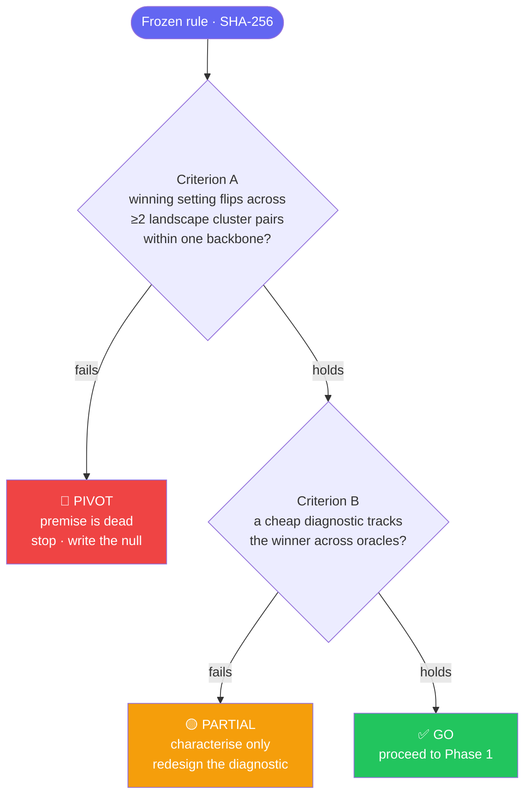

<div align="center">

# 🧬 Sample-Efficient Molecular Optimization
### Phase 0 — a pre-registered falsification test

*Can a cheap, up-front read of the fitness landscape predict which exploration setting will win — before you spend the oracle budget finding out?*

<br>


</div>

---

> [!IMPORTANT]
> **Start with [`GUIDE.md`](GUIDE.md).** It explains what the notebook does and maps each part of it to the section of the plan it satisfies. This README is the fast tour; the guide is the map.

---

> [!CAUTION]
> ## Environment hazard — read before creating the conda env
>
> **`scikit-learn` must be exactly `1.2.2`.** On `>= 1.3`, TDC's `drd2` and `jnk3` pickles load **without raising** and return `0.0` for every molecule. Nothing errors, no warning is printed, and every bioactivity result silently becomes garbage. The notebooks carry a tripwire that scores four probe molecules and asserts one is non-zero; if it fails, stop and fix the pin rather than working around it.
>
> **`environment.yml` is a generated file and its generator is frozen.** It is extracted from Part 11 of `src/phase0_source.py` by `python src/build_notebook.py`. That source is frozen because Phase 0 was run against it, so the pins were corrected *in the generated file* on 2026-11-22 — and **re-running `src/build_notebook.py` reverts them**, reintroducing `scikit-learn>=1.3`. The same applies to `.gitignore`. If you regenerate either, re-apply the corrections and check the header comments in both files.
>
> The versions that actually produced every result in this repository are recorded in [`Phase 2/PHASE2_RESULTS.md`](Phase%202/PHASE2_RESULTS.md) §7.

> [!WARNING]
> ## Runs are not individually reproducible from their seed
>
> All three phases ran 12 concurrent optimizations in one interpreter, and the seeding path (`phase0_lib.set_all_seeds`) sets **process-global** RNGs, so concurrent runs reseed and draw from each other's stream. A single cell re-run will not recover its recorded value unless you run single-threaded.
>
> Distributional results are unaffected — every seed is an honest independent draw and every bootstrap over seeds is valid. Reproducing a sweep means reproducing the *distribution*, not the manifest. No verdict changes. Full mechanism, evidence and consequences:
>
> - [`Phase 0/ADDENDUM-2026-11-22-reproducibility.md`](Phase%200/ADDENDUM-2026-11-22-reproducibility.md)
> - [`Phase 1/ADDENDUM-2026-11-22-reproducibility.md`](Phase%201/ADDENDUM-2026-11-22-reproducibility.md)
> - §3.2 and §9 of [`Phase 2/PHASE2_RESULTS.md`](Phase%202/PHASE2_RESULTS.md)
>
> The addenda are separate files because the Phase 0 and Phase 1 results documents are frozen — a guard in `tests/test_phase2.py` fails on any modification to them, and permits additions.

---

## ⚡ TL;DR

```text
   cheap landscape diagnostic  ──▶  predicts the winning explore setting?
                                           │
            ┌──────────────────────────────┼──────────────────────────────┐
            ▼                               ▼                               ▼
         GO ✅                         PARTIAL 🟡                       PIVOT 🔴
   signal holds → Phase 1      flips, but no diagnostic         premise is dead →
                               tracks it → redesign              stop, write the null
```

One frozen decision rule. One build command. One honest verdict.

---

## 📦 What's here

| Path | What it is |
|---|---|
| `phase0/phase0.ipynb` | **The deliverable.** 72 cells, end to end. |
| `GUIDE.md` | What it does, plan §→part mapping, deviations, how to run. |
| `src/phase0_source.py` | **Source of truth** (jupytext *percent* format). Edit this — never the `.ipynb`. |
| `src/phase0_lib.py` | *Generated.* Importable library (notebook minus demo cells). |
| `src/build_notebook.py` | **The build step.** Emits the notebook, the library and the assets below. |
| `tests/test_core.py` | 56 assertions on the metric, statistics and build artifacts. No torch/rdkit needed. |
| `environment.yml` · `scripts/run_sweep.py` · `scripts/slurm_phase0.sh` · `.gitignore` | *Generated.* |

Everything marked *generated* comes from **one build step**, so nothing is kept in sync by hand:

```bash
python src/build_notebook.py
```

> [!WARNING]
> The `.ipynb` is a **build product** — edits made inside Jupyter are overwritten on the next build.
> First run also writes `preregistration.json` (**commit it**), plus `results/`, `figures/`, `vendor/`, `data/`.

---

## 🚀 Quickstart

```bash
conda env create -f environment.yml && conda activate molopt   # after the first notebook run
python tests/test_core.py                                      # ~90s, needs only numpy/scipy/pandas
jupyter lab "phase0/phase0.ipynb"
```

Run the notebook **top to bottom once**. It vendors the molecular-optimization operators and prior, prefetches and times the property oracles, runs smoke tests on both backbones, and computes the landscape diagnostics. Then launch the sweep on the cluster:

```bash
python scripts/run_sweep.py --workers 8     # resumable; safe to interrupt
sbatch scripts/slurm_phase0.sh              # or under Slurm
```

Come back to **Part 10** for the verdict.

---

## 🖥️ Hardware

> [!NOTE]
> **VRAM is not the constraint.** The only thing on the GPU is a **4.18 M-parameter SMILES RNN**.

| | |
|---|---|
| Peak VRAM, one training run | **~1.0–1.5 GB** |
| 12 GB card | ~6–8 concurrent runs |
| 11 GB card | ~5–6 concurrent runs |

Every oracle and all of the graph-based GA are **CPU-only**, so throughput is set by **core count** — set `--workers` from cores, not VRAM. Part 1 measures this on your actual hardware rather than trusting the table.

```text
  full sweep:  8 oracles × 3 backbones × 3 settings × 3 seeds  =  216 runs
               1000 oracle calls each   ·   ~1 h @ 8 workers   ·   4–8 h serial
```

---

## 🔒 The rule that governs this phase

Part 0 **freezes** a decision rule and writes `preregistration.json` with a SHA-256. Part 10 **refuses to produce a verdict** if that hash no longer matches. The null hypothesis survives only if **both** criteria hold:



- **Criterion A** — the winning exploration setting flips across **≥2 landscape cluster pairs** within one backbone, confirmed by a *hierarchical* bootstrap (oracles resampled within cluster, then seeds within oracle).
- **Criterion B** — at least one cheap diagnostic tracks the winner across oracles (exact permutation Spearman, Holm-corrected, **α = 0.10** as a declared *screen*).

> [!CAUTION]
> **Commit `preregistration.json` before running anything.** Its entire value is being timestamped *earlier* than the results.

---

## 🧭 One decision before the full run

**Add an online bandit baseline** (e.g. EXP3 or successive halving over the settings as arms). It answers the first and most obvious objection — *"why predict the landscape when you could just adapt online?"* — and no result is convincing until that baseline is on the table.

---

## 🔍 Two things worth knowing before you read any number

<details open>
<summary><b>1 · AUC-top-10 has a ramp-in artifact</b></summary>

<br>

The integral starts from `prev = 0`, so a constant-`0.42` run scores `0.4179`. We reproduce the published formula **exactly** (verified to `1e-12` in `tests/test_core.py`), which means absolute AUC values are **not** mean rewards and must not be described as such.

</details>

<details open>
<summary><b>2 · Criterion A's bootstrap is hierarchical by design — and that costs power</b></summary>

<br>

With 2 oracles per cluster, resampling oracles is weak **on purpose**. Seed-only resampling confirmed **5/40** pure-noise trials; hierarchical confirmed **0/40**. The test is deliberately biased toward **PIVOT**, never toward a false **GO**.

</details>

---

## 📐 Deviations from published work, stated up front

| Deviation | Effect |
|---|---|
| **Selective Memory Purge** is a scaffold-cap adaptation, not a line-for-line port. | Held fixed within each setting → does **not** affect the rank-flip test. |
| **Budget check** uses `>=` where the reference uses `>`, capping the buffer at exactly `max_oracle_calls`. | AUC effect ~`1e-3`. |
| **Phase 0 varies one knob per backbone**, not the full grid. | A multi-knob ladder makes a flip uninterpretable — the grid belongs in Phase 1. |
| **Character-level tokenizer** inherited unchanged to stay comparable with the pretrained prior. | Held fixed across all settings → cannot confound the rank-flip test. |

---

<div align="center">

**Build once · pre-register · let the rule decide.**

<sub>Generated artifacts are reproducible from `src/build_notebook.py`. Edit the source, not the notebook.</sub>

</div>
